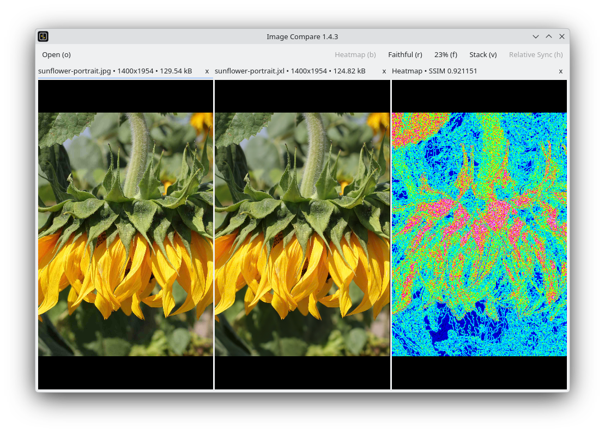

# Image Compare

[](https://github.com/gimletlove/imagecompare/releases)
[](https://flathub.org/apps/details/io.github.gimletlove.imagecompare)
[](https://aur.archlinux.org/packages/imagecompare)
[](./LICENSE.txt)

Compare two or more images side by side, or stack them and flip between them in the same spot. Zoom and pan stay in sync across all images, even at different resolutions. Build a heatmap to see where two images differ: check compression artifacts, pick the best copy of an image, or review edits and upscales.

Runs on Linux and Windows.



## Features

- Up to 12 images side by side in a grid, or stacked in one view
- Zoom and pan synced across all images; lock an image to move it on its own
- Relative sync keeps the same part of the image in view across different resolutions
- Luminance SSIM heatmaps of two images, which you can export
- Color-managed rendering using embedded profiles, or raw rendering
- Open images by drag and drop, the file picker, the command line or a file manager's Open With

## Keyboard Shortcuts

| Shortcut | Action |
|---|---|
| `o` | Open images |
| `f` | Toggle best fit / 100% zoom |
| `v` | Toggle stacked view |
| `Left` / `Right` | Switch the active image |
| `Enter` | Focus the active image |
| `h` | Toggle relative sync for different resolutions |
| `l` | Toggle synchronization lock for the active image |
| `r` | Toggle color-profile / raw rendering |
| `b` | Build heatmap |
| `Ctrl+W` | Close active image |
| `Ctrl+Left` / `Ctrl+Right` | Move image left / right |

## Command Line

```bash
imagecompare --stack --zoom 100 image1.jxl image2.jxl image3.jxl
```

| Option | Action |
|---|---|
| `--stack` | Start in stacked view |
| `--zoom <percent\|fit>` | Starting zoom, for example `100` |
| `--raw` | Start with raw rendering, ignoring color profiles |
| `--sync <relative\|absolute>` | Sync zoom and pan proportionally across resolutions (default), or at the same zoom level |
| `--help`, `--version` | Show help or version |

## Install

- **Flathub:** `flatpak install flathub io.github.gimletlove.imagecompare`
- **Arch Linux (AUR):** `yay -S imagecompare`
- **[GitHub Releases](https://github.com/gimletlove/imagecompare/releases):** DEB, RPM and portable zip for Linux, and a portable zip for Windows (extract and run `imagecompare.exe`)

## Build from Source

Needs a C++20 compiler, CMake 3.21+ and Qt 6.4+. Install Qt's image format plugins and KImageFormats to open WebP, AVIF and JPEG XL.

```bash
cmake -S . -B build
cmake --build build
./build/imagecompare
```

Windows builds come from the GitHub Actions release workflow.

## Acknowledgements

Heatmaps use the vendored [rmgr::ssim](https://github.com/romigrou/ssim) library by Romain Bailly.
